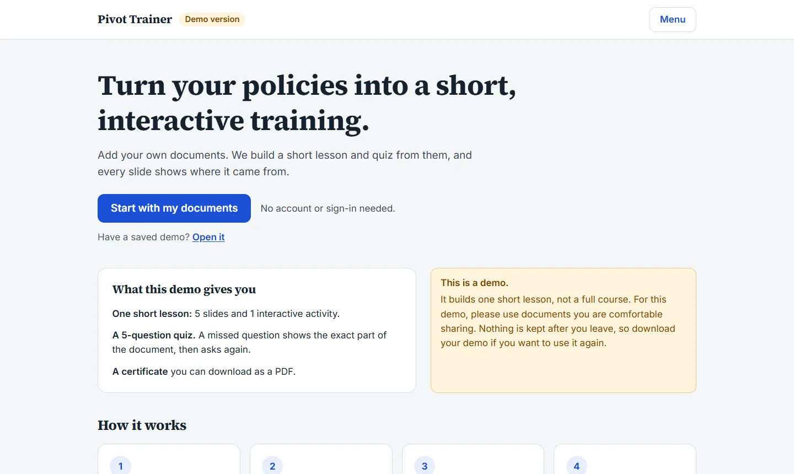
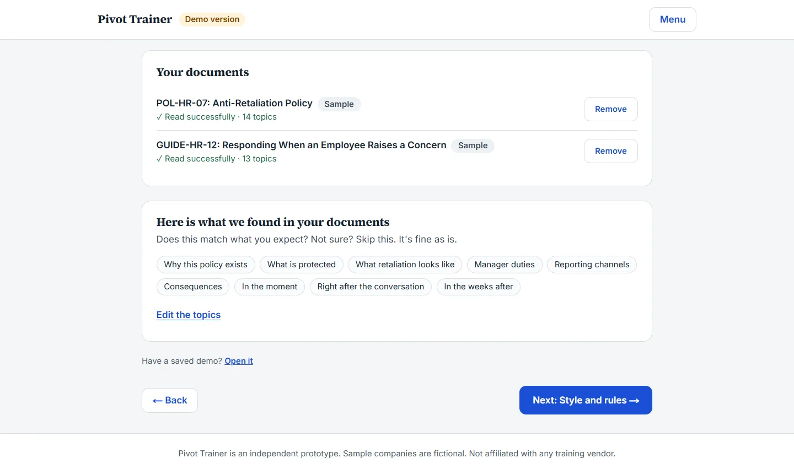
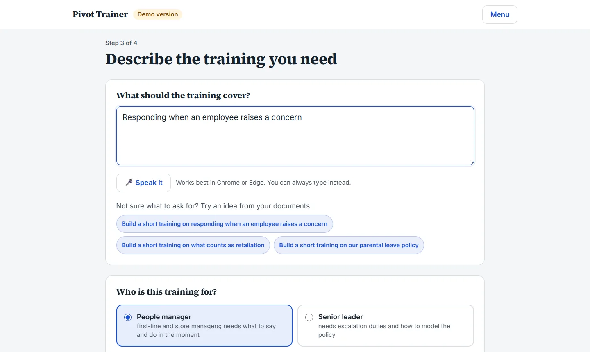
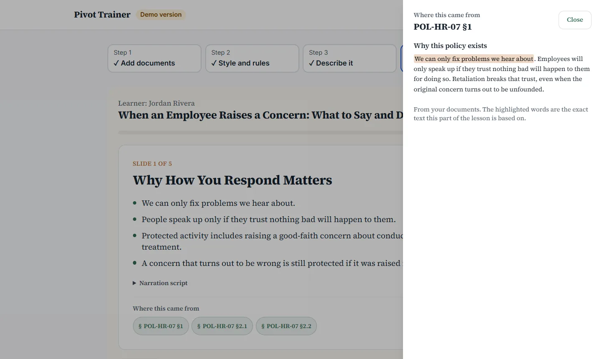
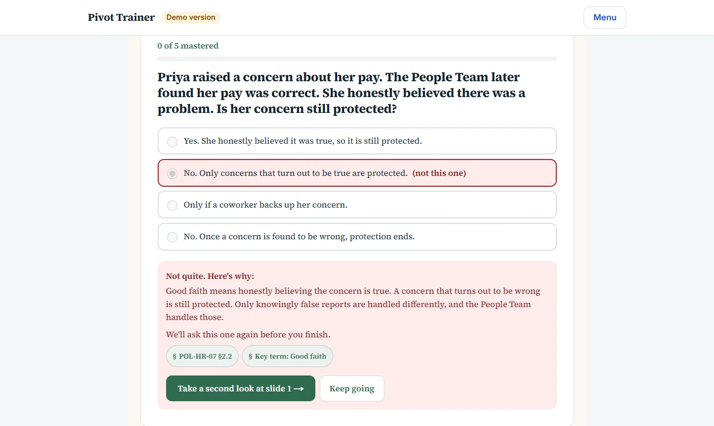
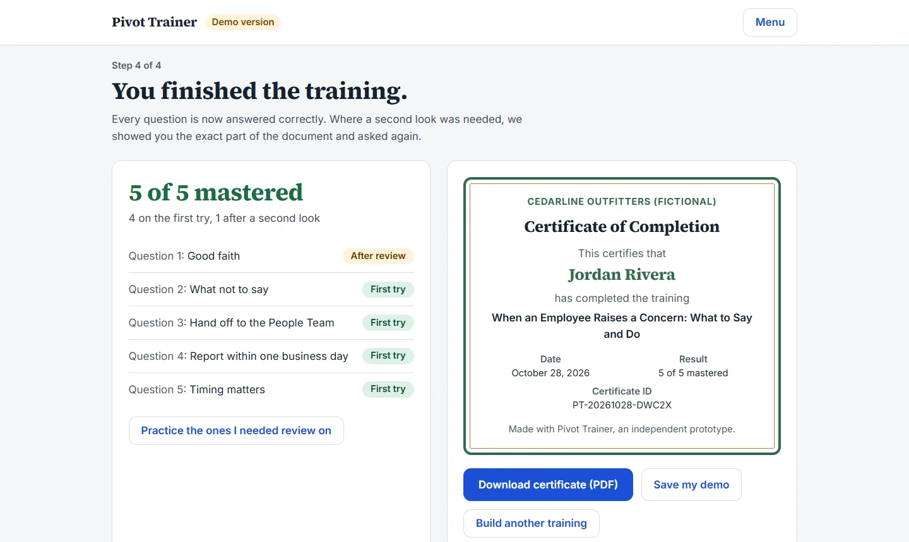

# Pivot Trainer

Short, interactive trainings generated from an organization's own SOPs and policies, with a citation on every slide and question.

**Live demo: https://pivot-trainer-demo.vercel.app** (no sign-in; try the sample company first, or add your own documents)



One engine, swappable **content packs**. The same app builds a field-procedure training for a security company, then pivots to an anti-retaliation training for people managers, with a different tone, look, and activity format, without changing any code.

> **Independent prototype.** Not affiliated with any training vendor. Every organization, document, and person in the sample packs is fictional.

## What it does

Built for HR and training people, not developers: one path, plain words, and the demo limits stated up front (5 slides, 1 interactive activity, 5 quiz questions).

1. **Add documents.** Upload Word, PDF, text, or Markdown, or paste text. The documents are split into topics (numbered, citable sections). Numbered headings are kept, unnumbered headings are numbered automatically, and documents with no headings get topic breaks suggested by Claude. The wording is never rewritten: the code slices the original text and verifies it.
2. **Style and rules** (optional, with defaults). Tone, rules the training follows, key terms, words to avoid, organization name, and brand color.
3. **Describe it.** Type or speak what the training should cover and pick who it's for. Clicking "Build my training" first checks that the documents cover the request: covered (build), partly covered (build the part we can, or add a document), or not covered (say so plainly and suggest ideas from the documents).
4. **Learn and certificate.** Slides and one activity, each showing where it came from. A missed question shows why, links to the exact slide, and comes back with its answers shuffled. The results and the PDF certificate unlock only at 5 of 5 mastered.

A fully built sample (a fictional retailer's anti-retaliation policy) can be opened from the Start screen and added to. A second sample (a fictional security company's procedures) ships as a demo file.

**Nothing is stored between visits**: no accounts, no database, no browser storage. Users keep a demo by downloading it as a file and opening it again later. The file holds the documents, style, rules, and generated training, never the learner's name or answers.

## Screens

| Step 1: documents in, topics found | Step 3: describe the training |
|---|---|
|  |  |
| **Where it came from: the exact section, quote highlighted** | **A missed question: why, the source, and a second look** |
|  |  |



## How grounding works

- Pack documents are split into **numbered sections** (`footage-request-sop#3.2`). Every slide, activity item, and quiz question must cite sections and include a short **verbatim quote**.
- **Code checks** (no AI) confirm each cited section exists, each quote appears word-for-word, quiz answers are valid, and nothing on the pack's never-say list appears.
- A **second model verifies** each claim against the full text of what it cites, and flags anything the source doesn't support.
- Anything flagged is mentioned before the lesson starts and stays marked on that slide or question.

`scripts/tamper-test.mts` plants a paraphrased quote, a never-say phrase, and a changed time limit in a real training, and confirms all three are caught.

## Adaptive format

The build picks a format from what the learner needs to do:

| Content | Activity |
|---|---|
| Procedural (steps, approvals, records) | Animated process flow, or put-in-order |
| Judgment (how to respond to people) | Scenario chat, or animated timeline |
| Terminology | Flip cards from the pack glossary |

## Content packs

```
packs/<name>/
  pack.json   style (tone, reading level, colors, font, corners), guardrails,
              audience roles, glossary, never-say list, starter prompts
  docs/*.md   the knowledge base; "## 2" / "### 2.1" headings become citable sections
  samples/    example trainings for illustration and a reliable live demo
```

Nothing about security or HR is hardcoded in the engine. To add a built-in sample, add a folder. Documents users add in the app are sent with each request; the server validates them and rebuilds the sections itself every time.

## Stack

- Next.js (App Router) + TypeScript + Tailwind
- Claude API, server-side only, using structured outputs with Zod schemas
  - Generation: Claude Opus 5.5 · Verification: Claude Sonnet 5.5 (set in `src/lib/config.ts`)
- Motion (animation), dnd-kit (drag and drop), pdf-lib (certificate)
- Web Speech API for voice input (Chrome and Edge; the text box is always available)
- No accounts, database, or browser storage: all working data lives in memory for the visit
- Public demo guardrails: per-visitor rate limits (5 trainings an hour) and a separate production API key with a monthly spending cap

## Run it

```bash
npm install
export ANTHROPIC_API_KEY=...   # server-side only
npm run dev
```

Other commands: `npm run build`, `npm run lint`.

Test scripts (run against a dev server on port 3210, or set `BASE_URL`):

```bash
node scripts/smoke.mjs security-sop "Build a short training on handling a customer footage request" out.json
npx tsx scripts/tamper-test.mts out.json
node scripts/e2e-flow.mjs shots/ my-sop.docx extra-doc.txt   # add --skip-builds to skip the Claude calls
```

## Roadmap

Full multi-chapter courses, a written Training Guide export, and a Video Package export (per-scene script and narration; every slide already carries a `narration` field). Optional narration and cross-browser voice input.
